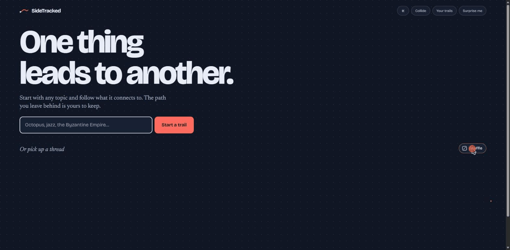
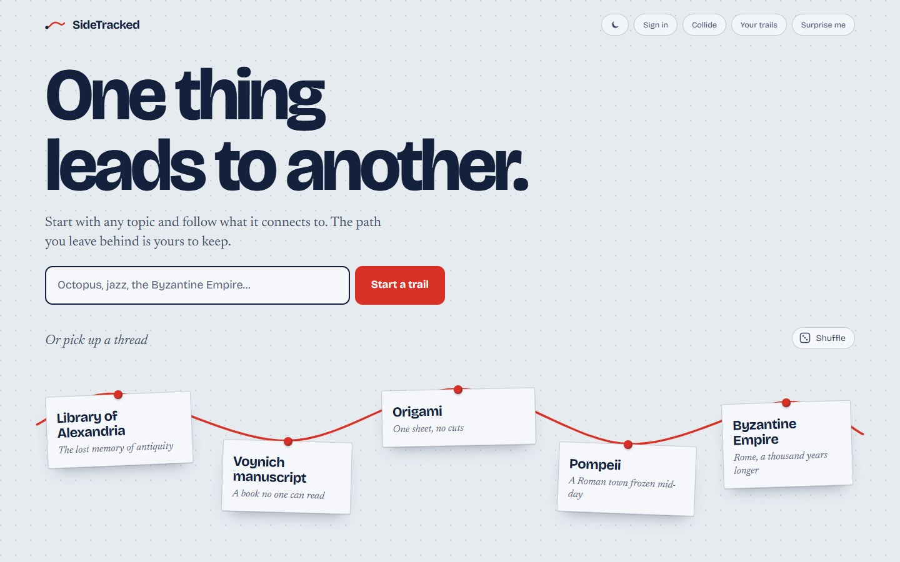
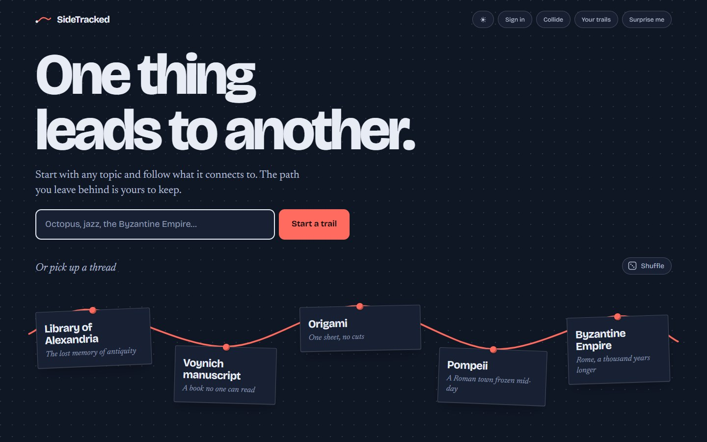
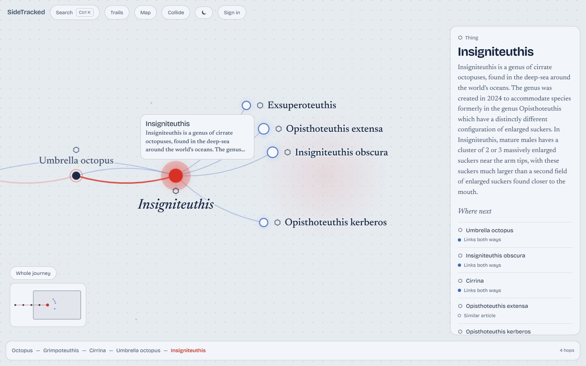
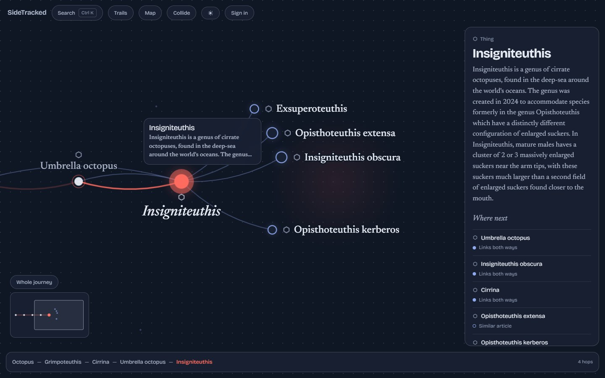
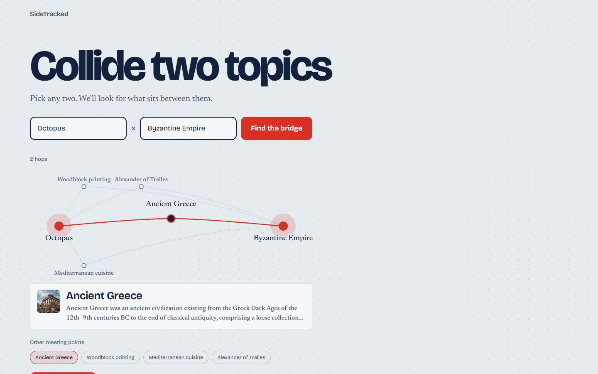
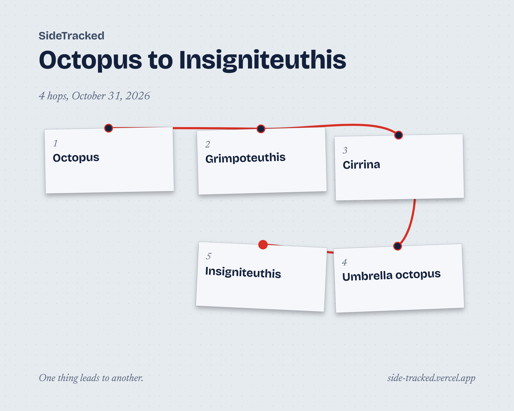

# SideTracked

**One thing leads to another.**

[](https://github.com/noeljj77/SideTracked/actions/workflows/ci.yml)

**Live demo: https://side-tracked.vercel.app**



SideTracked turns Wikipedia into a map you can wander. Start with any topic, follow what it connects to, and watch a red thread trace the path you take. The path is saved as a trail you can rewind, revisit, share as a poster and keep.

## Highlights

- **A living graph.** Related topics fan out around the one you are reading. Take a step and the map keeps your whole journey behind you.
- **Collide two topics.** Pick any two, and it finds the topics that sit between them.
- **Your trail is the product.** Rewind it, reopen it later, or download it as a poster.
- **Its own look.** Pinned notes on tracing paper, joined by a red thread, in light and dark.
- **Built to be used by anyone.** Keyboard friendly, contrast checked in both themes, and an automated accessibility audit.

## What it looks like

| The landing page | The night board |
| --- | --- |
|  |  |

| Exploring a topic | The same, at night |
| --- | --- |
|  |  |

| Collide two topics | A trail as a poster |
| --- | --- |
|  |  |

## What it does

**Exploring**

- **Start anywhere.** The landing page pins five random topics to a board, each with a line on why it is worth following. Reload for a new hand, or press Shuffle.
- **Explore as a graph.** The current topic glows red at the centre. Related topics fan out around it, found by combining similar articles with ones that link both ways, plus a few surprising tangents. Click one to take a step. Your whole journey stays on the map behind you, fading with age, and the view glides along with you.
- **Peek before you step.** Hover a topic to see its thumbnail and first lines. Arrow keys move between topics and `Enter` steps into one.
- **Handle the graph.** Scroll to zoom, drag empty space to pan, and double-click it (or press "Reset view") to come home. Pull a topic aside and it springs back. Rings of light spread out whenever you arrive somewhere.
- **Find your way on a long trail.** After three steps a minimap appears with a box for what you can see: click or drag it to move around. Pointing at a topic in the reading panel lights it up on the map, and each one says why it was offered. "Whole journey" zooms out to see everything.
- **See what kind of thing it is.** Small icons mark each topic as a person, place, event, idea or thing.
- **Read without leaving.** A side panel shows the summary and links to the full Wikipedia article.

**Your trail**

- **See your whole journey.** Press `M` (or "Map") to see every topic on your trail as a constellation you can pan and zoom. Pick a star to go back to it.
- **Keep your trail.** Every step is recorded along the bottom. Click an earlier step to rewind, or use the browser's back button. Trails are saved in your browser, and sync across devices if you sign in with Google.
- **Pick up where you left off.** Your last trail waits on the landing page as a pinned note.
- **Make a poster.** "Download poster" in Your trails turns any trail into an image: every topic pinned to a board and joined by the red thread.

**Collide**

- **Collide two topics.** Pick any two, like Octopus and Byzantine Empire, and SideTracked finds a topic that links them (Octopus, Ancient Greece, Byzantine Empire). Well-known stepping stones come first, and if no single topic links them it looks for a chain of two (Octopus, Ocean, New Orleans, Jazz). The answer is drawn as a glowing thread with the other meeting points hanging off it: click one to swap it in, or walk the chain as a trail. The result has its own link, so you can share it.

**Everywhere**

- **Light or dark.** The toggle in the top bar switches between the paper board and the night board. It follows your system setting until you choose.
- **Jump anywhere.** Press `Ctrl K` (or `/`) to search any topic, pick "Surprise me" for a random article, or open your saved trails.
- **Works on phones.** The panel becomes a bottom sheet and the graph reflows to a portrait layout.
- **Works without a mouse.** Every topic on the graph is a tab stop, and a "Skip to the list of topics" button jumps to the same topics as a plain list.

## How it works

- **Related topics** come from two sources that are merged. Wikipedia's "more like this" search finds similar articles, and one request for a topic's links finds the ones that link back. Topics found both ways rank highest; topics found only by their links, favouring well-developed articles, become the surprising tangents. If the links lookup fails, similarity alone is used.
- **Collide** reads both articles' outgoing links, then asks which of those link to the other end. Citation hubs, years and list pages are dropped, and well-known articles are ranked first. Three hops is the limit.
- **Topic types** come from Wikidata in one batched query per page of topics. They are optional: if the lookup fails, topics simply show without an icon.
- **Everything external is validated** with zod at the boundary, and failures become calm, typed messages rather than raw errors.
- **Server data and client state are kept apart.** TanStack Query holds topics and related topics; Zustand holds the trail, saved trails and interface state, and persists them with versioned migrations.

## Run it locally

You need [Node.js](https://nodejs.org) 22 or newer.

```bash
npm install
npm run dev
```

Then open the address Vite prints (usually http://localhost:5173).

## Accounts (optional)

SideTracked works without an account: trails are kept in your browser. If you set up Firebase, a "Sign in" button appears and saved trails sync across your devices. Signing in as a different account on the same browser never mixes the two accounts' trails.

1. Create a project at [console.firebase.google.com](https://console.firebase.google.com).
2. **Build → Authentication → Sign-in method:** enable **Google**.
3. **Build → Firestore Database:** create a database, then paste the contents of [`firestore.rules`](firestore.rules) into the **Rules** tab and publish.
4. **Project settings → Your apps:** add a Web app, then copy its config into a new `.env.local` (see [`.env.example`](.env.example)).
5. **Authentication → Settings → Authorized domains:** add your deployed domain (`localhost` is already allowed).

For a hosted site, add the same four `VITE_FIREBASE_*` values as environment variables in your host's settings and redeploy.

## Scripts

| Command | What it does |
| --- | --- |
| `npm run dev` | Start the dev server |
| `npm run build` | Typecheck and build for production into `dist/` |
| `npm run lint` | Lint with ESLint |
| `npm run typecheck` | Typecheck the app and the e2e tests |
| `npm test` | Run unit and component tests (Vitest) |
| `npm run test:e2e` | Run end-to-end tests (Playwright, uses Chrome) |
| `npm run screenshots` | Retake the README screenshots and social image (needs `npm run dev` running) |

## Quality

- **Tests.** Unit and component tests with Vitest and Testing Library, and end-to-end tests with Playwright that cover search, stepping, rewinding, reloading a trail, Collide, the overlays, the poster download and error states. The end-to-end tests use a fake Wikipedia, so nothing touches the live site. On a machine without Chrome, run `npx playwright install chrome` first.
- **Continuous integration.** GitHub Actions runs lint, typecheck, unit tests, the build and the end-to-end tests on every push and pull request.
- **Accessibility.** A contrast test checks every colour pair in both themes against WCAG AA, and an automated audit (axe) runs on each page in both themes.

## Built with

Vite, React 18 and strict TypeScript. React Router for pages, TanStack Query for data, Zustand for saved trails, Firebase (Google sign-in and Firestore) for optional accounts, d3-force and SVG for the graph, and zod to validate every API response. Styling is plain CSS Modules on a small set of design tokens. Hosted on Vercel.

## Project layout

```
src/
  app/          app shell, router, providers
  routes/       Landing, Explore, Collide and NotFound pages
  features/     graph, reader, trail, search, collide, account
  api/          Wikipedia, Wikidata and Firebase clients
  domain/       pure types and logic (ranking, bridges, kinds, curves)
  stores/       Zustand stores
  components/   shared UI pieces
  hooks/        shared hooks
  styles/       design tokens and global styles
e2e/            Playwright tests
scripts/        the screenshot script
docs/           README images
.github/        CI workflow
```

## Known limits

- It uses the English Wikipedia only.
- Collide finds bridges of up to three hops. Some pairs have nothing between them, and it says so.
- It depends on Wikipedia's public API being reachable. Without a connection, topics you have not opened yet cannot load.
- Fonts load from Google Fonts, so there is a brief fallback flash on a cold first visit.

## Data and credit

Article text comes from Wikipedia and is available under [CC BY-SA 4.0](https://creativecommons.org/licenses/by-sa/4.0/). SideTracked links every summary back to its source article. Topic types come from Wikidata, whose data is available under [CC0](https://creativecommons.org/publicdomain/zero/1.0/).

## Contributing

[CONTRIBUTING.md](CONTRIBUTING.md) documents the design direction, conventions, architecture and git workflow in detail, and is the best place to start before making changes.
